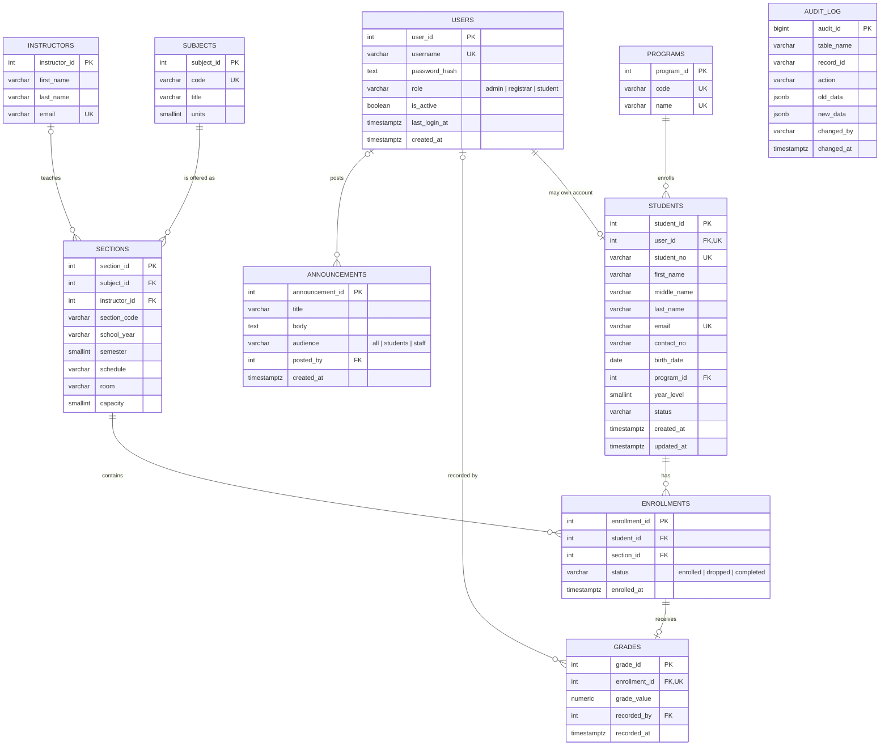

# IM2 Final Project Documentation
## Connecting Learners: A Student-Centered Information System for ICCT Colleges

**Course:** Advance Database System (IM2) | College of Computer Studies, ICCT Colleges Foundation Inc.  
**Database Engine:** PostgreSQL 16 (Local & Supabase Cloud PostgreSQL)  
**Application Stack:** Next.js (App Router), TypeScript, Tailwind CSS, Node `pg` driver  

---

## 1. System Overview

### 1.1 Background and Purpose
**Connecting Learners** is an integrated, student-centered Student Information System (SIS) designed for ICCT Colleges. In many academic workflows, student profiles, class schedules, section capacities, enrollment records, grades, and school announcements are fragmented across spreadsheets or disconnected forms. This leads to data redundancy, over-enrolled sections, inconsistent grade calculations, and a lack of accountability when records are altered.

Connecting Learners solves these problems by placing a **strictly normalized (BCNF) PostgreSQL database** at the core of the system, enforcing business rules, role-based access control, row-level security, transactional integrity, and automated audit logging directly inside the database engine, paired with a clean web interface for Administrators, Registrars, and Students.

### 1.2 Target Users and Roles
| Role | Application Role | PostgreSQL Role | Core Responsibilities |
|---|---|---|---|
| **Administrator** | `admin` | `sis_admin` | Full management of students, subjects, sections, enrollments, grades, announcements, user accounts, and read-only access to the immutable audit log. |
| **Registrar / Staff** | `registrar` | `sis_registrar` | Day-to-day academic operations: adding/updating students, enrolling/transferring/dropping students, encoding grades, and viewing reports. Cannot delete students, alter subjects/sections, or read the audit log. |
| **Student** | `student` | `sis_student` | Self-service portal: views own profile, enrolled subjects, term grades, weighted GPA, class schedules, and student announcements. Enforced by PostgreSQL Row-Level Security (RLS). |

### 1.3 System Architecture
1. **Presentation & Server Layer (Next.js App Router + TypeScript):** Server Components and Server Actions validate all user inputs with `zod` schemas and authenticate sessions using signed `httpOnly` JWT cookies (`jose`) backed by `bcrypt` password hashes (`pgcrypto` / `bcryptjs`).
2. **Database Security Context (`withDb` Transaction Wrapper):** Every database request runs inside a transaction that executes `SET LOCAL ROLE <sis_role>` and sets session context variables (`app.current_user` and `app.student_id`). This guarantees that PostgreSQL enforces `GRANT`/`REVOKE` privileges and Row-Level Security policies on every query.
3. **Database Layer (PostgreSQL 16 / Supabase):** Houses 10 BCNF-normalized tables, 4 analytical views, 2 transactional stored procedures, 4 triggers (including a `JSONB` audit log trigger), 3 database roles, and B-tree indexes.

---

## 2. Database Design (Requirement 1)

### 2.1 Entity-Relationship Diagram (ERD)



### 2.2 Schema Summary (10 Tables with PKs, FKs, and Constraints)
Requirement 1 requires at least 5 tables; our schema defines **10 tables** in [`db/01_schema.sql`](../db/01_schema.sql):

| # | Table | Primary Key | Foreign Keys | Key Constraints (`UNIQUE`, `CHECK`, `NOT NULL`) |
|---|---|---|---|---|
| 1 | `users` | `user_id` | — | `UNIQUE(username)`, `CHECK (role IN ('admin','registrar','student'))`, regex check on username |
| 2 | `programs` | `program_id` | — | `UNIQUE(code)`, `UNIQUE(name)`, non-empty code check |
| 3 | `instructors` | `instructor_id` | — | `UNIQUE(email)`, email format regex check |
| 4 | `students` | `student_id` | `user_id → users`, `program_id → programs` | `UNIQUE(student_no)`, `UNIQUE(email)`, `UNIQUE(user_id)`, `CHECK (year_level BETWEEN 1 AND 5)`, `CHECK (birth_date < CURRENT_DATE)`, `CHECK (status IN ('active','inactive','graduated','dropped'))` |
| 5 | `subjects` | `subject_id` | — | `UNIQUE(code)`, `CHECK (units BETWEEN 1 AND 6)` |
| 6 | `sections` | `section_id` | `subject_id → subjects`, `instructor_id → instructors` | `UNIQUE(subject_id, section_code, school_year, semester)`, `CHECK (semester IN (1,2,3))`, `CHECK (capacity BETWEEN 1 AND 100)`, regex on `school_year` (`YYYY-YYYY`) |
| 7 | `enrollments` | `enrollment_id` | `student_id → students`, `section_id → sections` | `UNIQUE(student_id, section_id)`, `CHECK (status IN ('enrolled','dropped','completed'))` |
| 8 | `grades` | `grade_id` | `enrollment_id → enrollments`, `recorded_by → users` | `UNIQUE(enrollment_id)` (1:0..1 with enrollment), `CHECK (grade_value IN (1.00, 1.25, 1.50, 1.75, 2.00, 2.25, 2.50, 2.75, 3.00, 5.00))` |
| 9 | `announcements` | `announcement_id` | `posted_by → users` | `CHECK (audience IN ('all','students','staff'))`, non-empty title |
| 10 | `audit_log` | `audit_id` | *(none — survives row deletion)* | `CHECK (action IN ('INSERT','UPDATE','DELETE'))`, append-only trigger |

### 2.3 Normalization Write-Up (UNF → 1NF → 2NF → 3NF → BCNF)

#### Unnormalized Form (UNF)
Consider a traditional student registration form containing student details and a repeating list of subjects taken:
```text
UNF(student_no, full_name, student_email, birth_date, program_code, program_name, year_level,
    { subject_code, subject_title, units, section_code, school_year, semester,
      schedule, room, capacity, instructor_name, instructor_email, enrollment_status, grade_value, remarks })
```

#### First Normal Form (1NF) — Atomic Attributes & No Repeating Groups
We split `full_name` into atomic columns (`first_name`, `middle_name`, `last_name`), split `instructor_name` into (`instructor_first_name`, `instructor_last_name`), remove the derived `remarks` attribute, and flatten the repeating group so each row represents one student enrolled in one section offering:
```text
R_1NF(student_no, first_name, middle_name, last_name, student_email, birth_date,
      program_code, program_name, year_level,
      subject_code, subject_title, units, section_code, school_year, semester,
      schedule, room, capacity, instructor_first_name, instructor_last_name, instructor_email,
      enrollment_status, grade_value)
Composite Primary Key: (student_no, subject_code, section_code, school_year, semester)
```

#### Functional Dependencies Identified in 1NF
- **FD1:** `student_no → first_name, middle_name, last_name, student_email, birth_date, program_code, program_name, year_level` *(Partial dependency on composite PK)*
- **FD2:** `program_code → program_name` *(Transitive dependency)*
- **FD3:** `subject_code → subject_title, units` *(Partial dependency on composite PK)*
- **FD4:** `(subject_code, section_code, school_year, semester) → schedule, room, capacity, instructor_email, instructor_first_name, instructor_last_name` *(Partial dependency on composite PK)*
- **FD5:** `instructor_email → instructor_first_name, instructor_last_name` *(Transitive dependency)*
- **FD6:** `(student_no, subject_code, section_code, school_year, semester) → enrollment_status, grade_value` *(Full dependency on composite PK)*

#### Second Normal Form (2NF) — Eliminate Partial Dependencies
We decompose `R_1NF` so every non-key attribute depends on the **whole** key of its relation:
1. **`STUDENTS_2NF`**(`student_no` [PK], `first_name`, `middle_name`, `last_name`, `student_email`, `birth_date`, `program_code`, `program_name`, `year_level`) — from FD1.
2. **`SUBJECTS_2NF`**(`subject_code` [PK], `subject_title`, `units`) — from FD3.
3. **`SECTIONS_2NF`**(`subject_code`, `section_code`, `school_year`, `semester` [Composite PK], `schedule`, `room`, `capacity`, `instructor_email`, `instructor_first_name`, `instructor_last_name`) — from FD4.
4. **`ENROLLMENTS_2NF`**(`student_no`, `subject_code`, `section_code`, `school_year`, `semester` [Composite PK], `enrollment_status`, `grade_value`) — from FD6.

#### Third Normal Form (3NF) — Eliminate Transitive Dependencies
In `STUDENTS_2NF`, `student_no → program_code → program_name` (FD2) is transitive. In `SECTIONS_2NF`, `(subject_code, section_code, school_year, semester) → instructor_email → instructor_first_name, instructor_last_name` (FD5) is transitive. Furthermore, `grade_value` only exists when a student receives a final grade (to avoid nullable grade metadata like `recorded_by` and `recorded_at` on ungraded enrollments), so we separate `grades` from `enrollments`. Introducing surrogate primary keys while preserving natural keys with `UNIQUE` constraints yields:
1. **`programs`**(`program_id` PK, `code` UK, `name` UK)
2. **`instructors`**(`instructor_id` PK, `first_name`, `last_name`, `email` UK)
3. **`students`**(`student_id` PK, `user_id` FK/UK, `student_no` UK, `first_name`, `middle_name`, `last_name`, `email` UK, `contact_no`, `birth_date`, `program_id` FK, `year_level`, `status`)
4. **`subjects`**(`subject_id` PK, `code` UK, `title`, `units`)
5. **`sections`**(`section_id` PK, `subject_id` FK, `instructor_id` FK, `section_code`, `school_year`, `semester`, `schedule`, `room`, `capacity`) with `UNIQUE(subject_id, section_code, school_year, semester)`
6. **`enrollments`**(`enrollment_id` PK, `student_id` FK, `section_id` FK, `status`, `enrolled_at`) with `UNIQUE(student_id, section_id)`
7. **`grades`**(`grade_id` PK, `enrollment_id` FK/UK, `grade_value`, `recorded_by` FK, `recorded_at`)

#### Boyce-Codd Normal Form (BCNF) Verification
A relation is in **BCNF** if and only if for every non-trivial functional dependency $X \rightarrow Y$, the determinant $X$ is a **superkey** (a primary key or candidate key enforced by `UNIQUE NOT NULL`).

| Relation | Non-Trivial Functional Dependencies ($X \rightarrow Y$) | Candidate Keys (Superkeys) | BCNF? |
|---|---|---|---|
| `users` | `user_id → all`, `username → all` | `{user_id}`, `{username}` | **Yes** |
| `programs` | `program_id → all`, `code → all`, `name → all` | `{program_id}`, `{code}`, `{name}` | **Yes** |
| `instructors` | `instructor_id → all`, `email → all` | `{instructor_id}`, `{email}` | **Yes** |
| `students` | `student_id → all`, `student_no → all`, `email → all`, `user_id → all` | `{student_id}`, `{student_no}`, `{email}`, `{user_id}` | **Yes** |
| `subjects` | `subject_id → all`, `code → all` | `{subject_id}`, `{code}` | **Yes** |
| `sections` | `section_id → all`, `(subject_id, section_code, school_year, semester) → all` | `{section_id}`, `{subject_id, section_code, school_year, semester}` | **Yes** |
| `enrollments` | `enrollment_id → all`, `(student_id, section_id) → all` | `{enrollment_id}`, `{student_id, section_id}` | **Yes** |
| `grades` | `grade_id → all`, `enrollment_id → all` | `{grade_id}`, `{enrollment_id}` | **Yes** |
| `announcements` | `announcement_id → all` | `{announcement_id}` | **Yes** |

Every determinant in every operational table is a candidate key. Derived attributes (`enrolled_count`, `seats_left`, `remarks`, `gpa`) are **never stored in tables**; they are computed dynamically via SQL Views (`03_views.sql`). Therefore, the schema is strictly in **BCNF**.

---

## 3. Advanced SQL (Requirement 2)

### 3.1 Complete CRUD Operations (`db/07_crud_examples.sql`)
Run command:
```powershell
psql -U postgres -h localhost -d sis_dev -f db/07_crud_examples.sql
```
Recorded output:
```text
 student_id | student_no | first_name | last_name 
------------+------------+------------+-----------
         31 | 2026-99999 | Test       | Crud
(1 row)

INSERT 0 1
 student_id | student_no | first_name | last_name | status 
------------+------------+------------+-----------+--------
         31 | 2026-99999 | Test       | Crud      | active
(1 row)

 student_no | last_name | first_name | program 
------------+-----------+------------+---------
 2026-00007 | Dela Cruz | Miguel     | BSBA
 2026-00017 | Dela Cruz | Miguel     | BSIT
 2026-00027 | Dela Cruz | Miguel     | BSBA
(3 rows)

 student_no | year_level | contact_no  |          updated_at           
------------+------------+-------------+-------------------------------
 2026-99999 |          2 | 09171234567 | 2026-10-16 11:37:35.702622+08
(1 row)

UPDATE 1
 student_id | student_no 
------------+------------
         31 | 2026-99999
(1 row)

DELETE 1
 audit_id | table_name | record_id | action | changed_by 
----------+------------+-----------+--------+------------
        3 | students   | 31        | DELETE | postgres
        2 | students   | 31        | UPDATE | postgres
        1 | students   | 31        | INSERT | postgres
(3 rows)
```

### 3.2 Views (`db/03_views.sql` — 4 Views Created, Minimum 2 Required)
1. **`v_section_roster`**: Joins `sections`, `subjects`, `instructors`, and `enrollments` to compute `enrolled_count` and `seats_left` (`capacity - enrolled_count`) per section.
2. **`v_student_grades`** (`WITH (security_invoker = true)`): Joins `enrollments`, `students`, `sections`, `subjects`, and `grades`, computing `remarks` (`Passed`, `Failed`, or `No grade yet`).
3. **`v_student_gpa`** (`WITH (security_invoker = true)`): Calculates unit-weighted GPA per student: `ROUND(SUM(grade_value * units) / NULLIF(SUM(units), 0), 2)`.
4. **`v_student_enrollment_summary`** (`WITH (security_invoker = true)`): Summarizes active enrolled subjects and total units per student.

### 3.3 Stored Procedures (`db/04_procedures.sql` — 2 Created, Minimum 1 Required)
1. **`sp_enroll_student(p_student_id INT, p_section_id INT)`**:
   - Verifies student exists and has `status = 'active'`.
   - Acquires a transaction-scoped advisory lock (`pg_advisory_xact_lock(1001, p_section_id)`) to prevent race conditions when two concurrent requests compete for the last seat.
   - Checks for duplicate enrollment and checks `v_taken >= v_capacity`.
   - Re-activates a previously dropped enrollment or inserts a new row.
2. **`sp_transfer_section(p_student_id INT, p_from_section INT, p_to_section INT)`**:
   - Validates both sections belong to the same subject, school year, and semester.
   - Marks `p_from_section` as `'dropped'` and calls `sp_enroll_student(p_student_id, p_to_section)` atomically.

### 3.4 Triggers (`db/05_triggers.sql` — 4 Triggers Created, Minimum 1 Required)
1. **`fn_audit()` (`trg_audit_*`)**: Attached `AFTER INSERT OR UPDATE OR DELETE` on `students`, `subjects`, `sections`, `enrollments`, `grades`, `users`, and `announcements`. Automatically strips `password_hash` and records `old_data` and `new_data` as `JSONB` along with `app.current_user`.
2. **`fn_touch_updated_at()` (`trg_students_touch`)**: Automatically updates `students.updated_at` on every `BEFORE UPDATE`.
3. **`fn_block_grade_for_dropped()` (`trg_grades_not_dropped`)**: Prevents inserting or updating a grade if the linked enrollment has `status = 'dropped'`.
4. **`fn_audit_log_immutable()` (`trg_audit_log_immutable`)**: Blocks any `UPDATE` or `DELETE` on `audit_log`, making the audit trail tamper-proof.

---

## 4. Transaction Management (Requirement 3)

Script: [`db/08_transaction_demo.sql`](../db/08_transaction_demo.sql)  
Run command:
```powershell
psql -U postgres -h localhost -d sis_dev -f db/08_transaction_demo.sql
```
This script demonstrates three transaction scenarios:
- **Part A (`BEGIN ... COMMIT`)**: Enrolls Student 10 into Section 8 and commits; the row persists after `COMMIT`.
- **Part B (`BEGIN ... ROLLBACK`)**: Enrolls Student 10 into Section 9, verifies the row is visible inside the transaction, and issues `ROLLBACK`; the row disappears after `ROLLBACK`.
- **Part C (Automatic Rollback on Exception inside `sp_transfer_section`)**: Student 10 attempts to transfer from Section 12 into Section 13 (which is full: 2 of 2 seats taken). Even though `sp_transfer_section` first updates Section 12 to `'dropped'`, the subsequent failure in `sp_enroll_student(10, 13)` aborts the transaction and rolls back the drop, leaving Student 10 safely `'enrolled'` in Section 12:

```text
--- Part C: failed transfer is rolled back automatically ---
Student 10 tries to move from section 12 to section 13, which is full.
BEGIN
psql:db/08_transaction_demo.sql:31: ERROR:  Section 13 is full (2 of 2 seats taken).
CONTEXT:  PL/pgSQL function sp_enroll_student(integer,integer) line 38 at RAISE
SQL statement "CALL sp_enroll_student(p_student_id, p_to_section)"
PL/pgSQL function sp_transfer_section(integer,integer,integer) line 28 at CALL
ROLLBACK
Enrollment in section 12 is still intact (status = enrolled):
 enrollment_id | student_id | section_id |  status  
---------------+------------+------------+----------
           128 |         10 |         12 | enrolled
(1 row)
```

---

## 5. Database Security (Requirement 4)

Script: [`db/06_roles.sql`](../db/06_roles.sql) and [`db/09_security_demo.sql`](../db/09_security_demo.sql)  
Run command:
```powershell
psql -U postgres -h localhost -d sis_dev -f db/09_security_demo.sql
```

### 5.1 Privileges Granted to Each Role
```text
    grantee    |  table_name   |           privileges           
---------------+---------------+--------------------------------
 sis_admin     | announcements | DELETE, INSERT, SELECT, UPDATE
 sis_admin     | audit_log     | SELECT
 sis_admin     | enrollments   | DELETE, INSERT, SELECT, UPDATE
 sis_admin     | grades        | DELETE, INSERT, SELECT, UPDATE
 sis_admin     | instructors   | DELETE, INSERT, SELECT, UPDATE
 sis_admin     | programs      | DELETE, INSERT, SELECT, UPDATE
 sis_admin     | sections      | DELETE, INSERT, SELECT, UPDATE
 sis_admin     | students      | DELETE, INSERT, SELECT, UPDATE
 sis_admin     | subjects      | DELETE, INSERT, SELECT, UPDATE
 sis_admin     | users         | DELETE, INSERT, SELECT, UPDATE
 sis_registrar | announcements | SELECT
 sis_registrar | enrollments   | INSERT, SELECT, UPDATE
 sis_registrar | grades        | INSERT, SELECT, UPDATE
 sis_registrar | instructors   | SELECT
 sis_registrar | programs      | SELECT
 sis_registrar | sections      | SELECT
 sis_registrar | students      | INSERT, SELECT, UPDATE
 sis_registrar | subjects      | SELECT
 sis_student   | announcements | SELECT
 sis_student   | enrollments   | SELECT
 sis_student   | grades        | SELECT
 sis_student   | instructors   | SELECT
 sis_student   | programs      | SELECT
 sis_student   | sections      | SELECT
 sis_student   | students      | SELECT
 sis_student   | subjects      | SELECT
```

### 5.2 Enforcement Verification (`09_security_demo.sql`)
- **`sis_student` with Row-Level Security (`app.student_id = '1'`)**: Running `SELECT student_id, student_no, last_name FROM students;` returns **only 1 row** (Student 1). Attempting `INSERT INTO students` or `SELECT * FROM users` fails with `ERROR: permission denied`.
- **`sis_registrar`**: Can call `CALL sp_enroll_student(11, 9)`, but attempting `DELETE FROM students` or `SELECT * FROM audit_log` fails with `ERROR: permission denied`.
- **`sis_admin`**: Can read `audit_log`, but attempting `DELETE FROM audit_log` fails with `ERROR: permission denied for table audit_log`.

---

## 6. Backup and Recovery (Requirement 5)

Scripts: [`db/backup.ps1`](../db/backup.ps1) and [`db/restore.ps1`](../db/restore.ps1)

### 6.1 Full Backup Command & Output
```powershell
powershell -NoProfile -File db/backup.ps1 -Url "postgresql://postgres@localhost:5432/sis_dev"
```
Output:
```text
Backing up to G:\Personal Project\connecting-learners-sis\db\backups\sis_20261015_203845.dump ...

Name                     SizeKB
----                     ------
sis_20261015_203845.dump   65.3
sis_20261015_203845.sql    62.8

Backup complete.
```

### 6.2 Restore into a Fresh Database & Verification Output
```powershell
powershell -NoProfile -File db/restore.ps1 `
  -DumpFile db/backups/sis_20261015_203845.dump `
  -AdminUrl "postgresql://postgres@localhost:5432/postgres" `
  -NewDb sis_restore_test
```
Output:
```text
Creating database sis_restore_test ...
Restoring G:\Personal Project\connecting-learners-sis\db\backups\sis_20261015_203845.dump into sis_restore_test ...
Verifying row counts:
     tbl     | count 
-------------+-------
 audit_log   |     0
 enrollments |   176
 grades      |    90
 sections    |    13
 students    |    30
 subjects    |    12
 users       |     7
(7 rows)

Restore complete.
```

---

## 7. Performance Optimization (Requirement 6)

Script: [`db/10_index_test.sql`](../db/10_index_test.sql)  
Run command:
```powershell
psql -U postgres -h localhost -d sis_dev -f db/10_index_test.sql
```
The script populates a 200,000-row table `perf_students` (~20,000 distinct surnames, ~10 matching rows per surname) and runs `EXPLAIN (ANALYZE, BUFFERS)` on `SELECT * FROM perf_students WHERE last_name = 'Surname12345';` before and after creating `CREATE INDEX ix_perf_students_last_name ON perf_students(last_name);`.

### 7.1 Execution Plan & Timing Comparison
| Metric | Before Index (`Seq Scan`) | After Index (`Bitmap Index Scan`) | Improvement |
|---|---|---|---|
| **Scan Strategy** | `Seq Scan on perf_students` | `Bitmap Index Scan on ix_perf_students_last_name` | Eliminated full-table scan |
| **Rows Removed by Filter** | 199,990 rows | 0 rows | 100% filter reduction |
| **Shared Buffers Read/Hit** | 1,667 blocks | 13 blocks (10 heap + 3 index) | **99.2% fewer pages read** |
| **Execution Time** | **21.463 ms** | **0.112 ms** | **~191× faster (99.48% reduction)** |

Recorded `EXPLAIN (ANALYZE, BUFFERS)` output:
```text
=== BEFORE INDEX: sequential scan ===
 Seq Scan on perf_students  (cost=0.00..4167.00 rows=10 width=35) (actual time=1.265..21.443 rows=10 loops=1)
   Filter: ((last_name)::text = 'Surname12345'::text)
   Rows Removed by Filter: 199,990
   Buffers: shared hit=1667
 Planning Time: 2.637 ms
 Execution Time: 21.463 ms

=== AFTER INDEX: index-based lookup (bitmap index scan) ===
 Bitmap Heap Scan on perf_students  (cost=4.50..42.30 rows=10 width=35) (actual time=0.073..0.082 rows=10 loops=1)
   Recheck Cond: ((last_name)::text = 'Surname12345'::text)
   Heap Blocks: exact=10
   Buffers: shared hit=10 read=3
   ->  Bitmap Index Scan on ix_perf_students_last_name  (cost=0.00..4.50 rows=10 width=0) (actual time=0.067..0.067 rows=10 loops=1)
         Index Cond: ((last_name)::text = 'Surname12345'::text)
         Buffers: shared read=3
 Planning Time: 0.233 ms
 Execution Time: 0.112 ms
```

---

## 8. Basic User Interface (Requirement 7)

The web interface in [`app/`](../app) implements all required screens:
1. **Login Screen (`/login`)**: Authenticates against `users` with bcrypt, sets a signed `httpOnly` cookie, and redirects based on role.
2. **Dashboard (`/dashboard`)**: Role-aware metrics and latest announcements.
3. **Students CRUD & Search (`/students`, `/students/new`, `/students/[id]/edit`)**: Search by student number, name, or email; filter by program and status; add, edit, and delete (Admin only) student records.
4. **Subjects CRUD & Search (`/subjects`, `/subjects/[id]/edit`)**: Add, edit, delete, and search subjects.
5. **Sections CRUD & Search (`/sections`, `/sections/new`, `/sections/[id]/edit`)**: Manage section offerings, schedules, rooms, instructors, and seat capacities.
6. **Enrollments (`/enrollments`)**: Enroll students via `CALL sp_enroll_student`, transfer sections atomically via `CALL sp_transfer_section`, drop enrollments, and search/filter enrollment records.
7. **Grades (`/grades`)**: Load section rosters and encode final grades (`1.00`–`3.00`, `5.00`).
8. **Reports / Summary Views (`/reports`)**: Displays three printable reports backed by SQL views (`v_section_roster`, `v_student_gpa`, and program/status breakdown).
9. **Student Self-Service (`/my`)**: Displays the logged-in student's profile, enrolled subjects, grades, and GPA (protected by PostgreSQL RLS).
10. **Users & Audit Log (`/users`, `/audit-log`)**: Admin user management and filterable `JSONB` audit log viewer.
