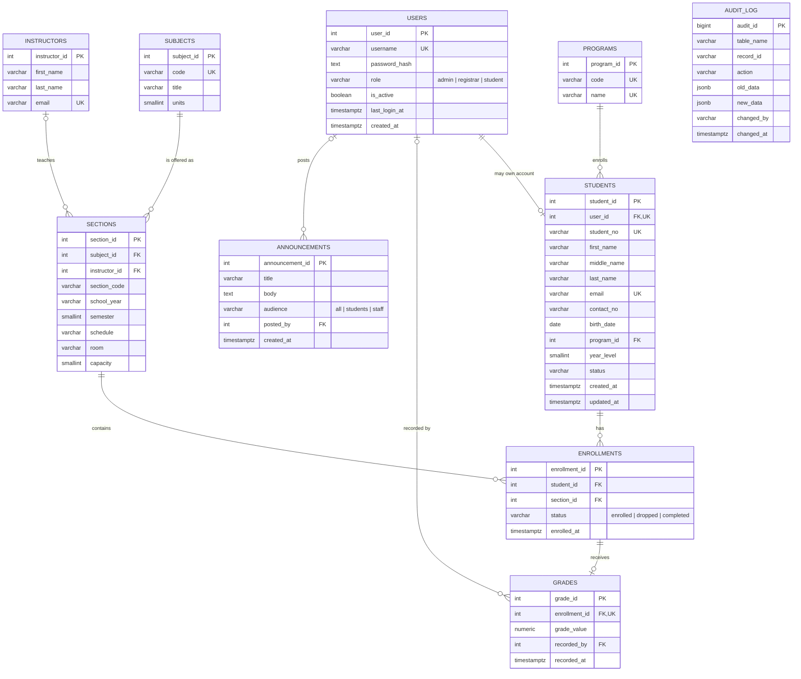

# Entity-Relationship Diagram

System: **Connecting Learners: A Student-Centered Information System for ICCT Colleges**
Database: PostgreSQL (script: [`db/sis_full.sql`](../db/sis_full.sql))

`AUDIT_LOG` has no foreign keys on purpose: audit rows must survive deletion of the records they describe. It is filled only by triggers.

## Relationships

| Relationship | Cardinality | Implemented by |
|---|---|---|
| Program → Students | 1 : N | `students.program_id` (ON DELETE RESTRICT) |
| User → Student | 1 : 0..1 | `students.user_id` UNIQUE (ON DELETE SET NULL) |
| Subject → Sections | 1 : N | `sections.subject_id` (RESTRICT) |
| Instructor → Sections | 0..1 : N | `sections.instructor_id` (SET NULL) |
| Student ↔ Section | M : N | resolved by `enrollments` (UNIQUE `student_id, section_id`) |
| Enrollment → Grade | 1 : 0..1 | `grades.enrollment_id` UNIQUE |
| User → Announcements / Grades | 1 : N | `posted_by`, `recorded_by` (SET NULL) |

## Mapping to the IM2 minimum requirements

| Requirement | Where |
|---|---|
| ≥ 5 tables with PK, FK, constraints | 10 tables in `db/01_schema.sql` |
| ERD | this file |
| Normalization to BCNF | `docs/NORMALIZATION.md` |
| CRUD, ≥ 2 views, ≥ 1 procedure, ≥ 1 trigger | `07_crud_examples.sql`, `03_views.sql` (4), `04_procedures.sql` (2), `05_triggers.sql` (4) |
| Transaction with COMMIT and ROLLBACK | `08_transaction_demo.sql` |
| ≥ 2 roles and privileges | `06_roles.sql` (3 roles), `09_security_demo.sql` |
| Backup and restore | `db/backup.ps1`, `db/restore.ps1`, `docs/EVIDENCE.md` |
| Index before/after | `10_index_test.sql` |
| UI: login, add/edit/delete/search, report | `app/` |
