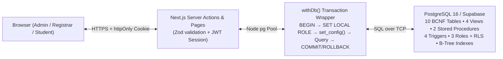

# Complete System Explanation, Thesis Writing Guide & Oral Defense Handbook
## Connecting Learners: A Student-Centered Information System for ICCT Colleges

This guide is written so that your group can **understand every line of the system**, **write your own thesis/capstone manuscript from scratch without guesswork**, and **confidently defend the project** in front of your facilitator or panel.

---

## PART 1: How the System Works (Plain-English & Technical Breakdown)

### 1.1 The Big Picture (3-Layer Architecture)
Think of **Connecting Learners** as a 3-layer system where **the PostgreSQL database is the ultimate authority**, and the **Next.js web application** is the user-friendly window into that database:



1. **No Direct Browser-to-Database Access:** The browser never talks directly to PostgreSQL or Supabase REST APIs. Every page load and form submission runs on the **Next.js server** (`app/src/app/...`).
2. **Double Defense (App + Database):**
   - **Layer 1 (Application):** When a user logs in (`app/src/app/login/actions.ts`), the server verifies their password against the `bcrypt` hash stored in `users.password_hash` and issues a signed `httpOnly` cookie (`sis_session`). Every page/action checks `requireRole(...)` (`app/src/lib/session.ts`).
   - **Layer 2 (Database Engine):** Whenever the app runs a query through `withDb(user, ...)` (`app/src/lib/db.ts`), it opens a PostgreSQL transaction (`BEGIN`) and runs:
     ```sql
     SET LOCAL ROLE sis_admin; -- or sis_registrar / sis_student
     SELECT set_config('app.current_user', $1, true), set_config('app.student_id', $2, true);
     ```
     Because of `SET LOCAL ROLE`, PostgreSQL itself enforces `GRANT`/`REVOKE` permissions and **Row-Level Security (RLS)** (`db/06_roles.sql`). Even if a developer wrote a bug in the UI, a student connection **cannot** read another student's grades or insert a record, and a registrar **cannot** delete a student or read the audit log.

---

### 1.2 How Each Database File Works (`db/`)

| File | What It Does | Why the Panel Cares |
|---|---|---|
| [`db/01_schema.sql`](../db/01_schema.sql) | Creates all **10 normalized tables** (`users`, `programs`, `instructors`, `students`, `subjects`, `sections`, `enrollments`, `grades`, `announcements`, `audit_log`), primary keys, foreign keys, `UNIQUE`/`CHECK` constraints, and foreign-key indexes. | Proves **Requirement 1** (≥ 5 tables, PKs, FKs, constraints, BCNF). |
| [`db/02_seed.sql`](../db/02_seed.sql) | Inserts realistic sample data: 7 login accounts (`bcrypt` hashed via `pgcrypto`), 4 ICCT programs (`BSIT`, `BSCS`, `BSBA`, `BSOA`), 6 instructors, 12 subjects, 13 sections (including a full 2-seat section for rollback testing), 30 students, 176 enrollments, 90 grades, and 3 announcements. | Gives you realistic data for your live demo immediately. |
| [`db/03_views.sql`](../db/03_views.sql) | Creates **4 SQL views**: `v_section_roster` (calculates `enrolled_count` and `seats_left`), `v_student_grades` (calculates `Passed`/`Failed` remarks), `v_student_gpa` (calculates unit-weighted GPA), and `v_student_enrollment_summary`. | Proves **Requirement 2 (Views)** and protects **BCNF** by never storing calculated fields in tables. |
| [`db/04_procedures.sql`](../db/04_procedures.sql) | Creates **2 stored procedures**: `sp_enroll_student` and `sp_transfer_section`. Uses `pg_advisory_xact_lock` so two people enrolling at the exact same millisecond cannot overfill a section. | Proves **Requirement 2 (Stored Procedure)** and **Requirement 3 (Transactions)**. |
| [`db/05_triggers.sql`](../db/05_triggers.sql) | Creates **4 triggers**: (1) `fn_audit()` logs `INSERT`/`UPDATE`/`DELETE` with `OLD` and `NEW` `JSONB` snapshots into `audit_log` (stripping `password_hash`); (2) `fn_touch_updated_at()` updates `students.updated_at`; (3) `fn_block_grade_for_dropped()` blocks grading a dropped enrollment; (4) `fn_audit_log_immutable()` prevents anyone from editing or deleting audit history. | Proves **Requirement 2 (Trigger)** and enterprise-grade data integrity. |
| [`db/06_roles.sql`](../db/06_roles.sql) | Creates 3 PostgreSQL roles (`sis_admin`, `sis_registrar`, `sis_student`), revokes default `PUBLIC` access, applies `GRANT`/`REVOKE` per table and procedure, and enables **Row-Level Security (RLS)** so `sis_student` can only see rows matching `fn_current_student_id()`. | Proves **Requirement 4 (Database Security)**. |
| [`db/07_crud_examples.sql`](../db/07_crud_examples.sql) | Standalone script demonstrating `INSERT`, `SELECT` (filter, `ILIKE` search, `JOIN`, `GROUP BY`), `UPDATE`, and `DELETE`, plus the resulting `audit_log` entries. | Proves **Requirement 2 (Complete CRUD)**. |
| [`db/08_transaction_demo.sql`](../db/08_transaction_demo.sql) | Demonstrates `BEGIN ... COMMIT`, manual `BEGIN ... ROLLBACK`, and automatic rollback when transferring a student into a full section (`sp_transfer_section`). | Proves **Requirement 3 (Transaction Management)**. |
| [`db/09_security_demo.sql`](../db/09_security_demo.sql) | Queries `information_schema.role_table_grants` to list all role privileges and switches into each role to prove allowed vs. `permission denied` actions. | Screenshot-ready proof for **Requirement 4**. |
| [`db/10_index_test.sql`](../db/10_index_test.sql) | Creates a 200,000-row test table `perf_students`, runs `EXPLAIN (ANALYZE, BUFFERS)` before and after `CREATE INDEX`, reducing query time from **~21.46 ms to ~0.11 ms (~191× faster)**. | Screenshot-ready proof for **Requirement 6 (Performance Optimization)**. |
| [`db/backup.ps1`](../db/backup.ps1) & [`db/restore.ps1`](../db/restore.ps1) | Automates `pg_dump` (full backup) and `pg_restore` into a clean database `sis_restore_test`, verifying row counts after restore. | Screenshot-ready proof for **Requirement 5 (Backup & Recovery)**. |
| [`db/sis_full.sql`](../db/sis_full.sql) | Single combined `.sql` file containing schema, sample data, views, procedures, triggers, and roles. | **Deliverable 1** required by your syllabus. |

---

## PART 2: Guide to Writing Your Thesis / Capstone Manuscript

Whether you are writing the **5–10 page IM2 Final Project Documentation** (already drafted for you in [`docs/DOCUMENTATION.md`](./DOCUMENTATION.md)) or a full **5-Chapter Thesis Manuscript** for *Connecting Learners: A Student-Centered Information System for ICCT Colleges*, use the breakdown below to write each section in your own words.

### Chapter 1: The Problem and Its Background

1. **Introduction / Context:**
   - Explain that Higher Education Institutions (HEIs) like ICCT Colleges handle thousands of student records across multiple campuses and academic terms.
   - A "student-centered" information system means students are not passive bystanders waiting in long registrar queues—they have transparent, real-time access to their own enrollment load, class schedule, grades, weighted GPA, and school announcements, while registrars and administrators operate on a single source of truth.
2. **Statement of the Problem (General & Specific):**
   - *General Problem:* How to design and develop **Connecting Learners**, a student-centered information system backed by a normalized relational database that eliminates data redundancy, prevents over-enrollment and unauthorized data tampering, and provides role-based self-service access for ICCT Colleges?
   - *Specific Problems:*
     1. How to eliminate redundant student, subject, program, and instructor data that cause update, insertion, and deletion anomalies? *(Solved by BCNF normalization across 10 tables).*
     2. How to prevent race conditions and partial updates when enrolling or transferring students between sections with strict seat capacities? *(Solved by ACID transactions and `sp_enroll_student` / `sp_transfer_section` with advisory locks).*
     3. How to enforce least-privilege access so that students only see their own records, registrars cannot delete students or alter audit logs, and administrators have full oversight? *(Solved by PostgreSQL roles `sis_admin`, `sis_registrar`, `sis_student` + Row-Level Security).*
     4. How to maintain an unalterable history of who changed any student, enrollment, or grade record and when? *(Solved by `AFTER INSERT/UPDATE/DELETE` JSONB audit triggers and an immutability trigger on `audit_log`).*
     5. How to ensure fast search performance and reliable disaster recovery as student records grow? *(Solved by B-tree indexing verified via `EXPLAIN ANALYZE` and automated `pg_dump`/`pg_restore` workflows).*
3. **Objectives of the Study:**
   - Mirror the 5 specific problems above as "To design a BCNF-normalized schema...", "To implement transactional stored procedures...", "To enforce role-based access control and Row-Level Security...", etc.
4. **Scope and Limitations:**
   - *Scope:* Student profile management, program & subject catalogs, section scheduling & capacity tracking, transactional enrollment & section transfers, Philippine 1.00–5.00 grade encoding, unit-weighted GPA calculation, targeted announcements, user account management, and JSONB audit logging across Admin, Registrar, and Student roles.
   - *Limitations:* Does not include tuition/cashier payment processing, online learning management (LMS/quizzes), or biometric attendance hardware. Grading stores the final subject grade per enrollment rather than prelim/midterm sub-components.

### Chapter 2: Review of Related Literature & Studies (Topics to Search)
When gathering citations for your RRL, search Google Scholar for:
1. **Student Information Systems (SIS) in Philippine HEIs** (streamlining registrar workflows, reducing queuing times, student self-service portals).
2. **Database Normalization (3NF & BCNF) in Academic Databases** (Codd's relational model, preventing update anomalies in enrollment systems).
3. **ACID Transactions and Concurrency Control in Course Registration** (preventing over-enrollment when multiple users register for limited seats).
4. **Defense-in-Depth Database Security & Row-Level Security (RLS)** (enforcing security inside the DBMS rather than relying only on application-layer checks).
5. **Database Indexing (B-Tree) and Query Optimization** (reducing disk I/O from sequential scans to index scans).

### Chapter 3: Methodology and Technical Design
- **SDLC Model:** Use **Iterative / Agile Prototyping** or **Modified Waterfall** (Phase 1: Requirements & FD Analysis → Phase 2: BCNF Database Design → Phase 3: SQL Objects & Security Implementation → Phase 4: Next.js Web UI Integration → Phase 5: Performance & Recovery Testing).
- **Diagrams to Include:**
  1. **System Architecture Diagram** (from Section 1.1 above).
  2. **Entity-Relationship Diagram (ERD)** (from [`docs/ERD.md`](./ERD.md)).
  3. **Normalization Progression (UNF → 1NF → 2NF → 3NF → BCNF)** (from [`docs/NORMALIZATION.md`](./NORMALIZATION.md)).
  4. **Data Dictionary** (list the columns, data types, and constraints of the 10 tables in [`db/01_schema.sql`](../db/01_schema.sql)).

### Chapter 4: Results, Testing, and Discussion
Include the 5 technical test results already verified in [`docs/DOCUMENTATION.md`](./DOCUMENTATION.md):
1. **Functional & CRUD Testing:** Show `07_crud_examples.sql` output and screenshots of the web UI.
2. **Transaction & Concurrency Testing:** Show `08_transaction_demo.sql` (`COMMIT`, `ROLLBACK`, and automatic rollback when transferring to full Section 13).
3. **Security & Role Privilege Testing:** Show the privilege matrix and `permission denied` proofs from `09_security_demo.sql`.
4. **Backup & Disaster Recovery Testing:** Show `backup.ps1` and `restore.ps1` restoring all 30 students, 176 enrollments, and 90 grades into `sis_restore_test`.
5. **Query Performance Benchmark:** Present the `10_index_test.sql` table comparing `Seq Scan` (**21.463 ms**, 1,667 buffers) vs. `Bitmap Index Scan` (**0.112 ms**, 13 buffers — **191× speedup**).

### Chapter 5: Summary, Conclusions, and Recommendations
- **Summary & Conclusion:** State that every objective (BCNF schema, advanced SQL views/procedures/triggers, ACID transactions, multi-role RLS security, verified backup/restore, and 191× index speedup) was achieved and integrated into a working web application.
- **Recommendations for Future Researchers:**
  1. Integrate an Accounting/Cashier module to link tuition assessment with enrollment status.
  2. Add prerequisite subject validation inside `sp_enroll_student` via a `subject_prerequisites` table.
  3. Expand the `grades` table or add a child table for Prelim, Midterm, and Finals component breakdown.
  4. Add email/SMS notifications when grades are encoded or announcements are posted.

---

## PART 3: How to Defend the Project (Q&A Cheat Sheet)

Below are the **most likely questions your facilitator or panel will ask**, along with the exact technical answers and where to point in your code.

### Q1: "Why is your database in BCNF? Prove it."
- **Answer:** "A table is in Boyce-Codd Normal Form (BCNF) if and only if for every non-trivial functional dependency $X \rightarrow Y$, $X$ is a superkey (a primary key or a `UNIQUE NOT NULL` candidate key).
  - First, in 1NF we eliminated repeating groups by giving each enrollment its own row.
  - Second, in 2NF we removed partial dependencies by separating `students`, `subjects`, `sections`, and `enrollments`.
  - Third, in 3NF we removed transitive dependencies by extracting `programs` (`program_code → program_name`) and `instructors` (`instructor_email → instructor_name`), and we separated `grades` from `enrollments` so ungraded enrollments don't have `NULL` grade metadata.
  - Finally, in every one of our 9 operational tables (`db/01_schema.sql`), every determinant—such as `students.student_no`, `students.email`, `subjects.code`, or the composite `(subject_id, section_code, school_year, semester)` in `sections`—has a `UNIQUE` or `PRIMARY KEY` constraint, making every determinant a superkey. And we **never store calculated columns** like `enrolled_count`, `seats_left`, `remarks`, or `gpa` in tables; those are computed dynamically in our 4 SQL views (`db/03_views.sql`)."

### Q2: "Why didn't you store `seats_left` or `gpa` as a column in `sections` or `students`?"
- **Answer:** "Storing `seats_left` in `sections` or `gpa` in `students` would violate 3NF/BCNF and introduce **update anomalies**—if an enrollment or grade changed and a query forgot to recalculate the summary column, the database would contradict itself. Instead, `v_section_roster` calculates `enrolled_count` and `seats_left` on the fly, and `v_student_gpa` calculates the unit-weighted GPA (`SUM(grade_value * units) / SUM(units)`)."

### Q3: "Where do you use transactions (`COMMIT` and `ROLLBACK`), and what happens if an error occurs halfway through?"
- **Answer:** "In two places:
  1. In SQL (`db/04_procedures.sql` and `db/08_transaction_demo.sql`), `sp_transfer_section(student_id, from_section, to_section)` first updates the student's current section to `'dropped'` and then calls `sp_enroll_student` for the target section. If the target section is full, `sp_enroll_student` raises an exception (`RAISE EXCEPTION 'Section % is full...'`), and PostgreSQL **automatically rolls back** the `'dropped'` update so the student never loses their original seat.
  2. In the web app (`app/src/lib/db.ts`), every request runs inside `withDb()`, which issues `BEGIN`, sets the PostgreSQL role and user context, runs the queries, and issues `COMMIT`—or `ROLLBACK` in the `catch` block if any statement fails."

### Q4: "What happens if two registrars try to enroll two different students into the last remaining seat of a section at the exact same time?"
- **Answer:** "Inside `sp_enroll_student` (`db/04_procedures.sql`, line 29), we call `PERFORM pg_advisory_xact_lock(1001, p_section_id);` before counting the enrolled seats. That acquires a transaction-level lock on that specific `section_id`. The second transaction waits until the first transaction commits or rolls back, so it is mathematically impossible to exceed `sections.capacity`."

### Q5: "How does your Database Security work? Is role checking only in Next.js or in PostgreSQL too?"
- **Answer:** "Both! Checking roles only in the frontend or backend code isn't database security. In `db/06_roles.sql`, we created three PostgreSQL roles: `sis_admin`, `sis_registrar`, and `sis_student`, revoked default permissions from `PUBLIC`, granted least-privilege table/procedure rights to each role, and enabled **Row-Level Security (RLS)** on every table. On every web request (`app/src/lib/db.ts`), the app runs `SET LOCAL ROLE sis_student` (or `sis_registrar` / `sis_admin`) and passes `app.student_id`. That means PostgreSQL itself blocks a student from querying another student's grades and blocks a registrar from deleting a student or reading `audit_log`."

### Q6: "Can an Admin delete or fake a record in `audit_log` to cover their tracks?"
- **Answer:** "No, for two independent reasons:
  1. In `db/06_roles.sql`, we explicitly ran `REVOKE INSERT, UPDATE, DELETE ON audit_log FROM sis_admin;`—`sis_admin` only has `SELECT` on `audit_log`. Audit rows can only be inserted by the `SECURITY DEFINER` trigger function `fn_audit()`.
  2. In `db/05_triggers.sql`, we attached `trg_audit_log_immutable` (`BEFORE UPDATE OR DELETE ON audit_log`), which raises an exception (`audit_log is append-only`) even if someone connects as the database owner."

### Q7: "Why does `audit_log` use `JSONB` for `old_data` and `new_data` instead of foreign keys?"
- **Answer:** "First, an audit log must survive the deletion of the record it describes—if a student row is deleted, a foreign key on `student_id` would either block the deletion or cascade-delete the audit trail. Second, one generic trigger function (`fn_audit()` in `db/05_triggers.sql`) audits 7 different tables with different columns by converting `OLD` and `NEW` rows to `JSONB` (`to_jsonb(NEW) - 'password_hash'`). Notice we also strip `password_hash` so password hashes never leak into the audit log."

### Q8: "Explain your Performance Optimization test. Why did PostgreSQL choose a `Bitmap Index Scan`?"
- **Answer:** "In `db/10_index_test.sql`, we inserted 200,000 rows into `perf_students` with 20,000 distinct surnames (~10 rows per surname).
  - **Before adding the index:** PostgreSQL had to perform a `Seq Scan` (Sequential Scan), reading all **1,667 disk buffer pages** and filtering out 199,990 rows, which took **21.463 ms**.
  - **After `CREATE INDEX ix_perf_students_last_name ON perf_students(last_name)`:** PostgreSQL used a `Bitmap Index Scan` + `Bitmap Heap Scan`, reading only **3 index pages and 10 heap pages (13 buffers total)** and finishing in **0.112 ms**—about **191 times faster**. PostgreSQL chooses a Bitmap Index Scan when a query matches multiple rows (~10 rows scattered across different table pages) because sorting the page pointers in a bitmap before reading the heap avoids visiting the same disk page twice."

---

## PART 4: Suggested Role Split for a 5-Member Group Defense

If you are presenting as a group of up to 5 members in a 5–7 minute live demo:

| Member | Assigned Focus (1–1.5 mins each) | What They Show / Defend |
|---|---|---|
| **Member 1 (Project Lead / Architect)** | System Overview, ERD, & BCNF Normalization | Explains the problem at ICCT Colleges, the 10-table ERD (`docs/ERD.md`), and how the schema reaches BCNF (`docs/NORMALIZATION.md`). |
| **Member 2 (Database Developer)** | Advanced SQL & Transactions | Shows Views (`03_views.sql`), Stored Procedures (`04_procedures.sql`), Triggers (`05_triggers.sql`), and runs `08_transaction_demo.sql` (`COMMIT` & `ROLLBACK`). |
| **Member 3 (Security & DBA Lead)** | Database Security, Backup/Restore, & Indexing | Runs `09_security_demo.sql` (Roles + RLS), shows `backup.ps1` / `restore.ps1`, and shows `10_index_test.sql` (`EXPLAIN ANALYZE` 21.46 ms → 0.11 ms). |
| **Member 4 (Frontend/Full-Stack — Staff Flow)** | Admin & Registrar Web UI | Logs in as `admin` / `registrar`, demos Student CRUD + Search, Enrollment (`sp_enroll_student`) + Section Transfer, Grade Encoding, Reports, and the Audit Log viewer. |
| **Member 5 (Frontend/Full-Stack — Student Flow)** | Student Self-Service Portal & Wrap-up | Logs in as `student1`, shows Dashboard, `/my` (Profile, Grades, GPA calculated by `v_student_gpa`), Class Schedule, and Announcements. |
